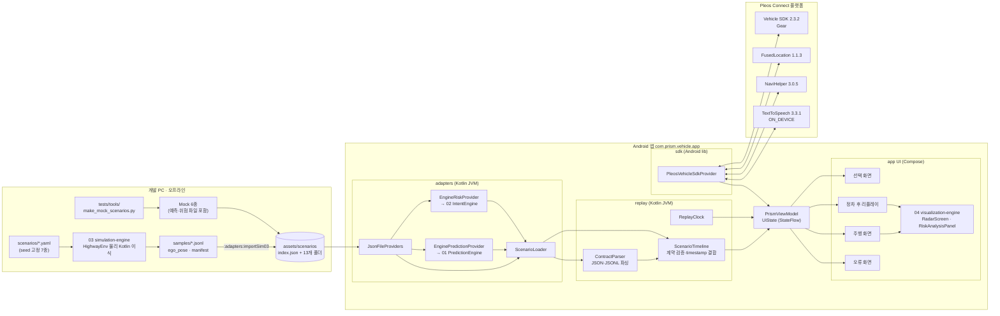
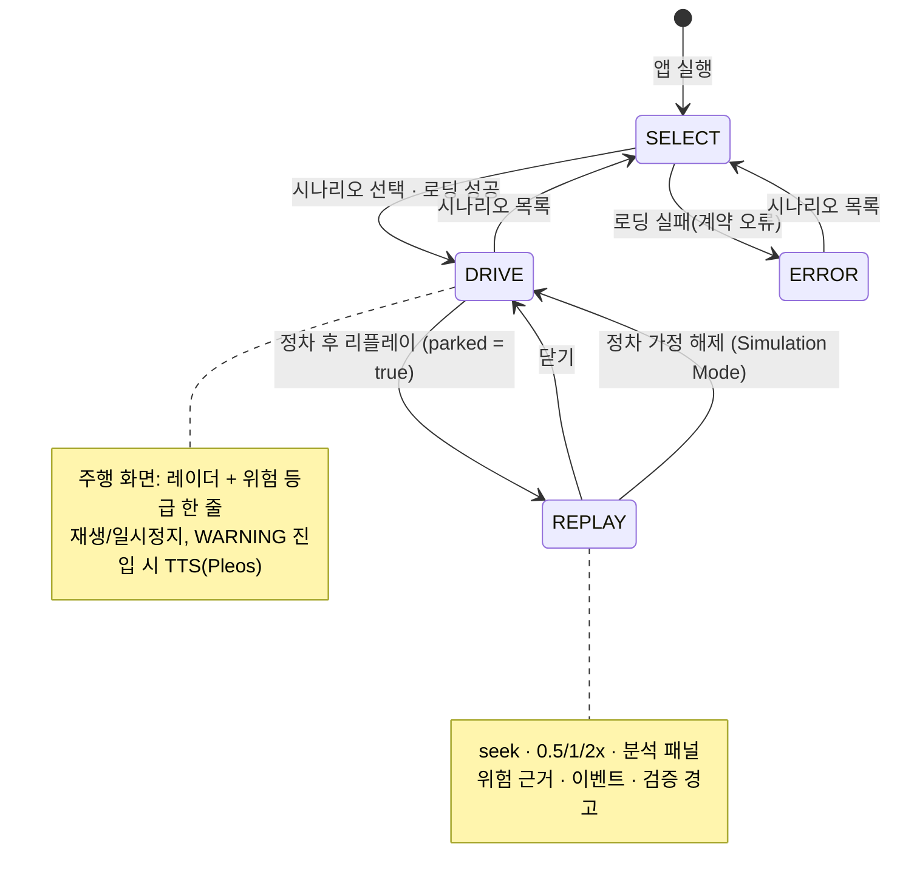
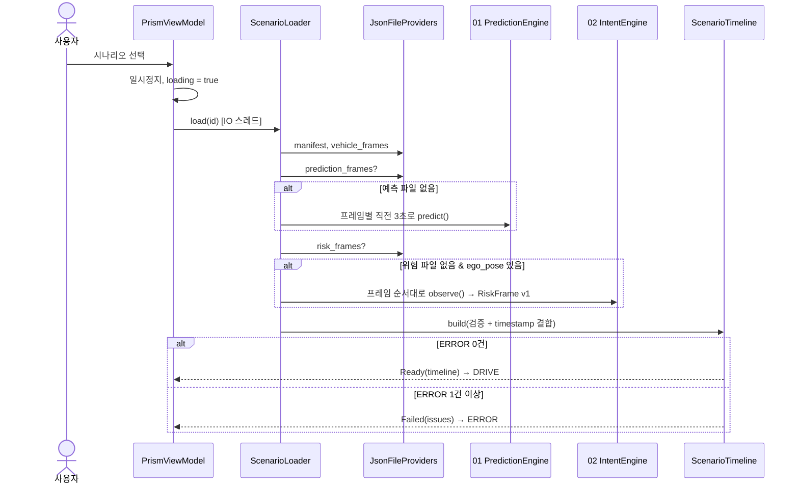

# PRISM 소프트웨어 요구사항 명세서 (SRS)

| 항목 | 내용 |
|---|---|
| 프로젝트 | PRISM: 주변 차량 연쇄 위험 시각화 차량용 앱 |
| 제출처 | 현대자동차그룹 차량용 앱 개발 공모전 |
| 문서 버전 | 1.0 |
| 기준 소스 | `develop` 브랜치 커밋 `3abc62b` (2026-11-13) |
| 앱 패키지 / 버전 | `com.prism.vehicle.app` / `0.1.0` (versionCode 1) |
| 작성 기준 | IEEE Std 830-1998 구조를 참고했습니다. 소스 코드에 구현된 내용만 요구사항으로 적었습니다. 근거가 없는 수치는 **[목표치]**, 구현되지 않은 항목은 **[미구현]**으로 표시합니다. |

> **중요 고지**
> PRISM은 미리 생성된 교통 시뮬레이션 결과를 차량 화면에서 재생해 보여 주는 **시각화 프로토타입**입니다. 실시간으로 충돌을 감지하거나 막는 장치가 아니고, 검증된 차량 안전 시스템도 아닙니다. 차량을 제어(제동·조향)하지 않으며, 주변 차량 위험 데이터는 모두 시뮬레이션(03 엔진) 또는 Mock 데이터입니다.

---

## 목차
1. 개요
2. 전체 설명
3. 기능 요구사항
4. 비기능 요구사항
5. 시스템 구조
6. 외부 인터페이스
7. 데이터 요구사항
8. 부록: 구현 현황과 제약 요약

---

## 1. 개요

### 1.1 목적
이 문서는 PRISM 차량용 앱의 기능·비기능 요구사항, 시스템 구조, 외부 인터페이스와 데이터 구조를 정의합니다. 공모전 심사위원, 개발팀(5개 파트), QA 담당자가 같은 기준으로 앱을 이해하고 검증할 수 있게 하는 것이 목적입니다. QA 문서(`docs/QA.md`)의 테스트 케이스는 이 문서의 요구사항 ID(FR/NFR)를 추적합니다.

### 1.2 범위
PRISM은 다섯 개의 독립 모듈로 구성됩니다.

| 파트 | 모듈(폴더) | 역할 | 실행 위치 |
|---|---|---|---|
| 01 | `prediction-engine` | 주변 차량 1~5초 후보 궤적 예측(물리 기반) | 앱 내부(소스 포함 빌드) |
| 02 | `engine02-kotlin` | 주변 차량 위험 등급 판정(규칙 기반) | 앱 내부(소스 포함 빌드) |
| 03 | `simulation-engine` | 재현 가능한 교통 시나리오 생성(HighwayEnv 물리 Kotlin 이식) | 개발 PC(오프라인 도구) |
| 04 | `visualization-engine` | 탑뷰 레이더, 위험 표시, 위험 분석 패널 UI 라이브러리 | 앱 내부(소스 포함 빌드) |
| 05 | `vehicle-integration` | Android 차량용 앱 본체, 데이터 계약 검증, 재생, Pleos SDK 연동 | 차량 디스플레이(Android) |

**범위에 포함되는 것**
- 시나리오(차량 프레임·예측·위험 데이터)를 앱에서 불러와 검증하고 시간 순서대로 재생합니다.
- 주행 중에는 화면 정보를 줄이고, 자세한 분석은 정차(P) 후 리플레이 화면에서만 보여 줍니다.
- Pleos SDK로 기어, 위치, 내비 상태를 읽고 음성 안내(TTS)를 합니다.

**범위에 포함되지 않는 것**
- 실시간 주변 차량 감지
- ADAS 센서 연동
- 차량 제어
- 서버 통신
- 사용자 계정·로그인
- 데이터 저장

### 1.3 용어 정의

| 용어 | 정의 |
|---|---|
| 자차 (ego) | 앱이 탑재된 차량. 모든 좌표의 원점입니다. |
| VehicleFrame | 한 시각의 자차와 주변 차량 상태(위치·속도·방향·크기·차선) 묶음. 공통 데이터 계약 v1 |
| PredictionFrame | VehicleFrame 시각 기준, 주변 차량별 미래 후보 궤적(01 출력) |
| RiskFrame | VehicleFrame 시각 기준, 주변 차량별 위험 등급·원인 코드·TTC·위험 영역(02 출력) |
| Scenario Manifest | 시나리오 메타데이터(길이, 간격, seed, 이벤트 주석, 데이터 출처, Mock 여부) |
| `ego_local_m` | 자차 기준 좌표계. x는 오른쪽(+), y는 전방(+), 단위는 m입니다. heading은 +x에서 반시계 방향(rad)이며, 전방은 π/2입니다. |
| 위험 등급 | `NORMAL`(정상) / `WATCH`(주의) / `WARNING`(경고) / `UNKNOWN`(판단 불가·판단 보류) |
| TTC | Time To Collision(충돌까지 남은 시간, 초). 위험 데이터가 값을 줄 때만 표시합니다. |
| Stale(데이터 누락) | 현재 재생 시각 직전의 VehicleFrame이 `step_ms × 2`보다 오래된 상태 |
| 정차(P) | 기어가 P단인 상태. Simulation Mode에서는 화면 스위치로 가정합니다. |
| Mock 데이터 | 다른 엔진 산출물이 도착하기 전에 쓰려고 만든 테스트용 데이터(`mock: true`) |
| Pleos | 현대자동차그룹 차량 소프트웨어 플랫폼. 이 문서에서는 Pleos Connect SDK와 에뮬레이터를 뜻합니다. |
| Simulation / Pleos Context / ADAS Mode | 앱 동작 모드(2.3절) |

### 1.4 대상 사용자

| 구분 | 사용 상황 | 앱이 제공하는 것 |
|---|---|---|
| **운전자 (주행 중)** | 기어 P 이외. 시선 분산을 최소화해야 함 | 레이더 화면 + 위험 등급 한 줄 배너. Pleos Context Mode에서는 WARNING 진입 시 음성 안내 1회 |
| **운전자·동승자 (정차 중)** | 기어 P(또는 Simulation Mode의 정차 가정) | 리플레이: 시간 이동, 배속, 위험 분석 패널, 원인 코드, 이벤트 주석 |
| **시연자·심사위원** | 공모전 시연 | Simulation Mode에서 시나리오 13종 선택·재생 |

> 코드에는 운전자와 동승자를 구분하는 기능(좌석 감지, 별도 동승자 화면 등)이 **없습니다**. 화면은 "정차 여부"로만 나뉩니다. 동승자 전용 기능은 **[미구현]**입니다.

### 1.5 참고 문서
- IEEE Std 830-1998, *Recommended Practice for Software Requirements Specifications*
- `vehicle-integration/README.md`, `INTEGRATION_STATUS.md`, `SDK_COMPATIBILITY.md`
- `simulation-engine/README.md`, `prediction-engine/README.md`, `engine02-kotlin/README.md`, `visualization-engine/README.md`
- Pleos 개발자 문서(document.pleos.ai): 권한 정책, Vehicle·FusedLocation·NaviHelper·TextToSpeech

---

## 2. 전체 설명

### 2.1 시스템 개요
PRISM은 "주변 차량 하나의 돌발 행동이 다른 차량을 거쳐 자차에 연쇄적으로 영향을 주는 상황"을 시각적으로 보여 주는 차량용 앱입니다.

1. 개발 단계에서 03 엔진이 재현 가능한 교통 시나리오를 만듭니다.
2. 앱은 그 시나리오를 읽고, 그 자리에서 01 예측과 02 위험 판정을 실행합니다(결과 파일이 없을 때).
3. 결과를 04 레이더 UI로 재생합니다.
4. 주행 중에는 위험 등급만 짧게 보여 주고, 정차 후에 상세 분석을 엽니다.

### 2.2 주요 기능 요약

| 분류 | 기능 |
|---|---|
| 데이터 | 시나리오 목록 로드, JSON/JSONL 파싱, 계약 검증(스키마 버전·ID 연결·좌표계·시간 동기화·유한 수치), 오류 보고 |
| 엔진 | 01 궤적 예측 앱 내 실행, 02 위험 등급 판정 앱 내 실행 |
| 주행 화면 | 탑뷰 레이더(차량·예측 궤적·위험 영역·위험 등급 표시), 위험 등급 배너, 재생/일시정지 |
| 정차 후 리플레이 | 시간 이동(seek), 0.5/1/2배속, 상세 레이더, 위험 분석 패널, 위험 근거·이벤트 주석·검증 경고 목록 |
| 차량 연동 | Pleos SDK 기어(P단 판정)·위치·내비 상태·TTS, SDK 상태 패널, 수명주기에 맞춘 세션 해제 |
| 안전·투명성 | "시뮬레이션 결과 재생 · 실시간 감지 아님", "MOCK 데이터" 배지, ADAS Mode 비활성 |

### 2.3 사용자 유형과 앱 모드

| 모드 | 데이터 출처 | SDK 호출 | 정차 판정 | 상태 |
|---|---|---|---|---|
| Simulation Mode (기본) | assets 시나리오 | 호출 안 함 | 화면의 "정차(P) 가정" 스위치 | 구현 |
| Pleos Context Mode | assets 시나리오 + 실제 SDK(기어·위치·내비·TTS) | 호출 | SDK 기어 = `PARK` | 구현 (에뮬레이터 확인) |
| ADAS Mode | — | — | — | **비활성** (공개 SDK에 주변 차량 객체 API 없음) |

### 2.4 운영 환경

| 항목 | 내용 | 근거 |
|---|---|---|
| 타깃 플랫폼 | Pleos Connect (Android 14 기반 차량 인포테인먼트) | `targetSdk = 34`, `SDK_COMPATIBILITY.md` |
| 최소 OS | Android 9 (API 28) | `minSdk = 28` |
| 컴파일 SDK | API 35 | `compileSdk = 35` |
| 검증 환경 1 | AVD `Pleos_Connect_v2.1.0`: Android 14, x86_64, **2560×1440** 가로, 차량 홈 런처가 있는 다중 창 | `INTEGRATION_STATUS.md` |
| 검증 환경 2 | AVD `Medium_Phone_API_36.0`: Android 16, 1080×2400 세로(좁은 화면 레이아웃 확인용) | `INTEGRATION_STATUS.md` |
| 실차 | **미검증** | — |
| Android Automotive OS | AAOS 전용 선언(`android.hardware.type.automotive`, Car App Library)은 **없음**. 일반 Android 앱으로 빌드됨 | `AndroidManifest.xml` |
| 하드웨어 요구 | 터치 디스플레이. 음성 안내에는 Pleos TTS 서비스(ON_DEVICE) 필요. 네트워크 불필요 | 코드 |
| APK 크기 | Debug APK 약 47 MB (assets 2.7 MB 포함) | `INTEGRATION_STATUS.md` |

### 2.5 제약사항
1. **안전 주장 금지:** 실차 ADAS나 실시간 충돌 방지라고 주장하지 않습니다. 화면에 "시뮬레이션 결과 재생 · 실시간 감지 아님" 배지를 항상 표시합니다.
2. **차량 제어 금지:** `CONTROL_*` 권한을 선언하지 않습니다. 제동·조향 API도 호출하지 않습니다.
3. **최소 권한:** 실제로 호출하는 API의 권한만 선언합니다. 승인되지 않은 권한을 쓰면 Pleos 앱 심사를 통과할 수 없습니다.
4. **값을 만들어 내지 않음:** 누락 값을 0으로 채우지 않습니다. 근거 없는 확률(`confidence`)과 TTC도 만들지 않습니다(null 유지).
5. **ADAS 비활성:** 공식 접근 권한을 확인하기 전까지 ADAS Mode를 비활성으로 둡니다.
6. **빌드 환경:** JDK 17, Gradle 8.13, AGP 8.7.2, Kotlin 2.0.21이 필요합니다. 경로에 한글이 있으면 JVM 테스트가 실패하므로 영문 경로에서 빌드합니다.
7. **배포:** Release 서명 키를 저장소에 두지 않습니다. 시연·제출은 Debug APK를 기준으로 합니다.

### 2.6 가정과 의존성
- 주변 차량 데이터는 공통 계약 v1(`schema_version` 1.x, `ego_local_m`)을 따른다고 가정합니다.
- 02 위험 판정은 검증된 도로 좌표가 필요합니다. 그래서 03의 보조 파일 `ego_pose.jsonl`이 있는 시나리오에서만 실행하고, 차선 폭은 03 직선 도로 기본값 4.0 m로 고정합니다.
- Pleos Gear API는 공식 도메인 표에 없습니다. 에뮬레이터에서는 `CAR_DRIVE` 권한으로 동작하지만, **심사 전 승인 확인이 필요**합니다.

---

## 3. 기능 요구사항

표기 규칙: 각 요구사항은 **설명 / 입력 / 처리 / 출력 / 예외 처리**로 기술하고, 마지막에 구현 위치(근거)를 적습니다.

### FR-01 앱 실행과 초기화
- **설명:** 앱이 실행되면 시나리오 목록을 불러오고, 기본 모드(Simulation)로 시나리오 선택 화면을 보여 줍니다.
- **입력:** 런처 실행 (`MAIN`/`LAUNCHER` 인텐트)
- **처리:**
  1. ViewModel이 IO 스레드에서 `scenarios/index.json`을 읽습니다.
  2. Pleos SDK 상태를 구독합니다.
  3. Simulation Mode에서는 SDK를 호출하지 않습니다.
- **출력:** 상단 바, 앱 모드 버튼, 시나리오 목록, Pleos SDK 상태 패널을 표시합니다.
- **예외 처리:** `index.json`이 없거나 형식이 잘못되면 빈 목록으로 처리하고 "assets/scenarios/index.json 에 시나리오가 없습니다"를 표시합니다(앱 종료 없음).
- **근거:** `MainActivity.kt`, `PrismViewModel.init`, `JsonFileProviders.scenarioIds`

### FR-02 앱 모드 선택
- **설명:** 사용자가 Simulation / Pleos Context 모드를 선택합니다. ADAS Mode는 선택할 수 없습니다.
- **입력:** 선택 화면의 모드 버튼 터치
- **처리:**
  1. Pleos Context를 선택하고 앱이 포그라운드이면 SDK 세션을 시작합니다(FR-16~19).
  2. 다른 모드로 바꾸면 SDK 세션을 해제합니다.
  3. ADAS 선택 요청은 무시합니다.
- **출력:** 선택한 모드 버튼이 강조됩니다. 상단 바에 모드 배지가 표시되고, Pleos Context Mode에서는 "차량 상태·위치만 실제 SDK, 주변 차량 위험은 시뮬레이션" 배지가 추가됩니다.
- **예외 처리:** ADAS 버튼은 비활성 상태로 표시하고, "ADAS Mode: 공식 접근 권한 확인 전 비활성" 안내를 보여 줍니다.
- **근거:** `PrismViewModel.setMode`, `Screens.kt SelectScreen/TopBar`

### FR-03 시나리오 목록 표시와 선택
- **설명:** 재생할 수 있는 시나리오를 목록으로 보여 줍니다.
- **입력:** `scenarios/index.json`(문자열 배열), 목록 항목 터치
- **처리:** 항목을 터치하면 FR-04 로딩을 시작하고, 로딩 중에는 "불러오는 중…"을 표시합니다.
- **출력:** 시나리오 ID 카드 목록. 현재 13종입니다.
  - Mock 6종: `normal`, `rear_approach`, `sudden_brake`, `lane_change`, `chain_reaction`, `dropout`
  - 03 시뮬레이션 7종: `sim_normal`, `sim_sudden_braking`, `sim_rear_approach`, `sim_lane_change`, `sim_merge`, `sim_chain_reaction`, `sim_sensor_dropout`
- **예외 처리:** 목록이 비어 있으면 안내 문구를 표시합니다(FR-01).
- **참고:** 목록에는 사람이 읽는 제목이 아니라 ID가 표시됩니다(제목은 주행 화면에 표시).
- **근거:** `SelectScreen`, `assets/scenarios/index.json`

### FR-04 시나리오 로딩과 데이터 계약 검증
- **설명:** 선택한 시나리오의 파일을 읽어 계약 v1을 검증하고, 재생용 타임라인을 만듭니다.
- **입력:** `scenarios/<id>/` 아래 파일
  - 필수: `scenario_manifest.json`, `vehicle_frames.jsonl`
  - 선택: `prediction_frames.jsonl`(없으면 `.json`), `risk_frames.jsonl`(없으면 `.json`), `ego_pose.jsonl`
- **처리:**
  1. JSON/JSONL을 파싱합니다. 깨진 줄은 줄 번호와 함께 오류로 기록합니다.
  2. 아래 오류 규칙을 검사합니다. 하나라도 걸리면 재생할 수 없습니다.

     | 검사 항목 | 오류가 되는 경우 |
     |---|---|
     | 스키마 | major 버전이 1이 아님 |
     | 매니페스트 | `step_ms` ≤ 0 |
     | VehicleFrame | 없음, timestamp 중복·음수, `coordinate_system`이 `ego_local_m`이 아님, `ego_id`가 manifest와 다름, ego 차량 누락, 차량 ID 중복, NaN/Inf 수치, 차량 크기 ≤ 0 |
     | 예측·위험 | 없는 vehicle ID 참조, timestamp 중복, `confidence`가 [0,1] 범위 밖, `dt_ms` ≤ 0, `ttc_s` 음수·비유한, polygon 꼭짓점 3개 미만 |

  3. 아래 경고 규칙을 기록합니다. 경고가 있어도 재생은 됩니다.
     - 프레임 간격이 `step_ms × 2`를 넘는 누락 구간
     - 마지막 timestamp가 `duration_ms`를 넘음
     - 같은 timestamp의 VehicleFrame이 없는 예측·위험 프레임(표시하지 않고 버림)
     - 예측·위험 파일 없음
  4. 예측·위험은 **같은 timestamp의 VehicleFrame 좌표계에서만** 결합합니다.
- **출력:** 성공하면 주행 화면(FR-07)으로 이동하고, 실패하면 오류 화면(FR-15)으로 이동합니다.
- **예외 처리:**
  - 필수 파일이 없거나 오류가 1건 이상이면 재생 불가로 처리합니다.
  - 예측·위험 파일이 없으면 FR-05·FR-06의 엔진 계산으로 대체하고, 그래도 없으면 차량만 재생합니다.
  - 모든 실패는 예외가 아니라 오류 목록으로 보고합니다(앱 종료 없음).
- **근거:** `ContractParser.kt`, `ScenarioTimeline.build`, `ScenarioLoader.load`, `JsonFileProviders`

### FR-05 01 궤적 예측 앱 내 실행
- **설명:** 예측 파일이 없는 시나리오에서는 앱이 01 PredictionEngine을 직접 실행해 후보 궤적을 만듭니다.
- **입력:** VehicleFrame 목록, 각 시각 기준 직전 3,000 ms 기록, 선택적으로 `ego_pose.jsonl`
- **처리:**
  1. 프레임마다 직전 3초 기록으로 예측합니다.
  2. 기록 창의 모든 시각에 ego_pose가 있으면 실제 자차 자세를 쓰고, 하나라도 없으면 01이 속도로 자세를 추정합니다.
  3. 예측 모델은 물리 기반입니다.
     - 등속(CV), 등가속(CA) 모델을 씁니다. 관측이 부족하면 CV로 대체합니다.
     - 4 m/s² 감속 후보와, 차선 폭 3.5 m·4초 차선 변경 후보를 만듭니다.
     - 속도는 55 m/s, 가속도는 8 m/s²로 상한을 둡니다.
- **출력:** PredictionFrame. 후보 모드는 `lane_keep`, `braking`, `lane_change_left`, `lane_change_right`이고, `dt_ms` 1~5초, `confidence = null`(학습·보정 없음)입니다.
- **예외 처리:** 입력 오류(`IllegalArgumentException`)가 난 프레임은 건너뛰고 "예측 실패" 경고로 기록합니다.
- **근거:** `EnginePredictionProvider`, `prediction-engine/src/main/kotlin/com/prism/prediction/*`

### FR-06 02 위험 등급 판정 앱 내 실행
- **설명:** 위험 파일이 없는 시나리오에서는 앱이 02 엔진(IntentEngine)을 프레임 순서대로 실행해 RiskFrame을 만듭니다.
- **입력:** VehicleFrame 목록, `ego_pose.jsonl`(필수), 03 직선 도로 형상(차선 폭 4.0 m 고정)
- **처리:**
  1. 자차 자세로 각 차량을 도로 좌표(d, s)에 투영합니다.
  2. 차량별 의도를 추정하고, 아래 규칙으로 등급을 정합니다.

     | 조건 | 등급 |
     |---|---|
     | 관측이 불확실함 | `UNKNOWN` |
     | 표본 시점에 차체가 실제로 겹침 | `WARNING` |
     | 등속 투영 겹침 가설, 움직임 변화, 양보 의도 | `WATCH` |
     | 그 밖 | `NORMAL` |

  3. 입력이 차단된 차량은 `UNKNOWN`과 `ENGINE02_INPUT_BLOCKED`로 표시합니다.
- **출력:** RiskFrame v1
  - 원인 코드에는 연구용 표식(`ENGINE02_RESEARCH_ONLY`, `UNCALIBRATED_HEURISTIC`)이 포함됩니다.
  - `ttc_s`는 항상 null입니다.
  - 위험 영역은 등속 차체 궤적으로 만든 polygon입니다.
- **예외 처리:**
  - `ego_pose.jsonl`이 없으면 도로 좌표를 추측하지 않고 계산하지 않습니다. 이때 "파일 없음: 02 위험도를 계산하지 않음" 경고를 남깁니다.
  - 같은 시각의 자세가 없거나 계산에 실패한 프레임은 건너뛰고 경고를 남깁니다.
- **제약:** 03 시뮬레이션 시나리오에서 02는 대부분 `NORMAL`을 냅니다. 급감속과 후방 접근은 02가 다루지 않는 범위입니다.
- **근거:** `EngineRiskProvider`, `engine02-kotlin/.../RiskFrameV1.kt`, `IntentEngine.kt`

### FR-07 주행 화면: 탑뷰 레이더
- **설명:** 현재 재생 시각의 자차·주변 차량·예측 궤적·위험 영역을 탑뷰로 표시합니다.
- **입력:** 현재 시각의 Snapshot(VehicleFrame·PredictionFrame·RiskFrame), 표시 모드 `DRIVING`
- **처리:**
  1. 05 계약 DTO를 04 모델로 변환합니다.
  2. 차선 수와 폭은 `lane_id`와 차량 가로 위치의 중앙값으로 추정합니다. 추정할 수 없으면 기본값 3.5 m를 씁니다.
  3. 데이터 지연 기준은 `step_ms × 2`로 04와 맞춥니다.
- **출력:** 04 RadarScreen
  - 위험 등급은 **색 + 아이콘 + 문구**로 표시합니다. 회색은 정상, 노랑 삼각형은 주의, 빨강 아이콘은 경고, 파란 점선과 "?"는 판단 보류입니다.
  - 그 밖에 차량 스프라이트, 예측 궤적, 위험 영역(충돌 위험 영역과 점유 영역을 구분)을 그립니다.
  - 관측이 끊긴 위험 차량은 추정 위치에 점선 고스트로 표시합니다.
- **예외 처리:** 차량 프레임이 없거나 오래되면 판단 보류로 표시합니다. 표시 범위 밖 차량의 라벨은 그리지 않습니다(이전에 확인된 crash 수정 사항).
- **근거:** `ui/Radar.kt RadarSlot, LaneLayout`, `visualization-engine/ui/RadarScreen`

### FR-08 주행 화면: 위험 등급 배너
- **설명:** 주행 중에는 현재 최고 위험 등급을 한 줄로만 표시합니다.
- **입력:** Snapshot
- **처리:** 최고 등급은 `WARNING` > `WATCH` > `UNKNOWN` > `NORMAL` 순서로 고릅니다. 데이터가 stale이거나 RiskFrame이 없으면 `UNKNOWN`입니다.
- **출력:** 24sp 굵은 글씨 배너. 상황별 문구는 다음과 같습니다.

  | 상황 | 배너 문구 |
  |---|---|
  | 데이터 stale | "데이터 누락 — 현재 상태 알 수 없음" |
  | RiskFrame 없음 | "위험 정보 없음 (RiskFrame 없음)" |
  | WARNING | "WARNING · 주변 차량 위험" |
  | WATCH | "WATCH · 주의 관찰" |
  | UNKNOWN | "UNKNOWN · 판단 불가" |
  | 그 밖 | "NORMAL" |

  배경색은 빨강/노랑/회색 계열입니다.
- **예외 처리:** 위 표의 데이터 누락과 위험 정보 없음 문구가 예외 상황 표시입니다.
- **근거:** `Screens.kt LevelBanner`, `Snapshot.topLevel`

### FR-09 재생 제어
- **설명:** 시나리오를 실제 시간에 맞춰 재생, 일시정지, 처음부터 재생합니다.
- **입력:** 재생 / 일시정지 / 처음부터 버튼
- **처리:**
  1. 33 ms 주기로 실제 경과 시간에 배속을 곱해 재생 위치를 진행합니다.
  2. 끝에 닿으면 자동으로 멈춥니다. 끝난 상태에서 재생을 누르면 0초부터 다시 시작합니다.
- **출력:** "현재 / 전체 s" 시간 표시. 버튼 문구는 "재생" / "일시정지" / "처음부터"입니다.
- **예외 처리:** 0 이하의 경과 시간은 무시합니다. 재생 위치는 [0, duration]으로 제한합니다.
- **근거:** `ReplayClock`, `PrismViewModel.play/pause`

### FR-10 정차(P) 판정
- **설명:** 리플레이를 열 수 있는지 판단하기 위해 정차 여부를 정합니다.
- **입력:** Simulation Mode에서는 "정차(P) 가정" 스위치, Pleos Context Mode에서는 SDK 기어 상태
- **처리:** 모드별로 정차 여부를 다음과 같이 판정합니다.

  | 모드 | 정차로 보는 조건 |
  |---|---|
  | Simulation | 스위치가 켜져 있음 |
  | Pleos Context | 기어 = `PARK` |
  | ADAS | 항상 정차 아님 |

  Simulation Mode에서 리플레이 중 스위치를 끄면 주행 화면으로 돌아갑니다.
- **출력:** "정차 후 리플레이" 버튼 활성/비활성, 차단 사유 문구
- **예외 처리:** 차단 사유 문구는 다음과 같습니다.

  | 상황 | 문구 |
  |---|---|
  | Simulation, 스위치 꺼짐 | "정차(P) 상태에서만 리플레이를 열 수 있습니다. '정차 가정' 을 켜세요." |
  | 기어를 읽지 못함 | "기어 상태를 읽지 못해 정차 여부를 확인할 수 없습니다 (<사유>)" |
  | P 이외 기어 | "현재 기어 <기어>. P단에서만 리플레이를 열 수 있습니다." |

- **제약:** Pleos Context Mode에서 리플레이를 연 뒤 기어가 P에서 다른 단으로 바뀌어도 리플레이 화면은 자동으로 닫히지 **않습니다** [개선 필요].
- **근거:** `UiState.parked`, `UiState.replayBlockedReason`, `PrismViewModel.setSimulatedParked/openReplay`

### FR-11 정차 후 리플레이
- **설명:** 정차 상태에서 시나리오를 자세히 다시 봅니다.
- **입력:** 시간 이동 슬라이더, 재생/일시정지, 배속(0.5x·1x·2x), 닫기
- **처리:**
  1. 진입할 때 재생을 일시정지합니다.
  2. 슬라이더 값은 [0, duration]으로 제한합니다.
  3. 배속은 0.5/1/2만 허용합니다.
- **출력:**
  - 레이더(표시 모드 `DETAIL`: 차량 ID, 원인 칩, 상세 표시)
  - 위험 등급 배너
  - "현재 / 전체 s · 프레임 나이 Nms"
  - 위험 분석 패널(FR-12)
  - 위험 근거, 이벤트 주석, 검증 경고 목록(FR-13)
- **예외 처리:** 정차가 아니면 진입 버튼이 비활성입니다(FR-10). 허용되지 않은 배속은 생성 단계에서 거부합니다.
- **근거:** `Screens.kt ReplayScreen`, `ReplayClock.SPEEDS`

### FR-12 위험 분석 패널
- **설명:** 리플레이 화면에서 현재 시각의 위험을 요약 분석합니다.
- **입력:** Snapshot, 레이더와 같은 도로 설정
- **처리:**
  1. 04 SceneBuilder로 장면을 만든 뒤 RiskAnalyzer로 분석합니다.
  2. 대수는 레이더에 그려진 장면에서 세므로 레이더와 항상 일치합니다.
- **출력:** 다음 다섯 영역을 표시합니다.

  | 영역 | 내용 |
  |---|---|
  | 현재 위험 상태 | 전체 위험 수준, 경고·주의·판단 보류 대수 |
  | 주요 위험 | 원인 문구, 상대 위치(차로·전후 거리, 시뮬레이션 좌표 기준), 내 경로와 겹침 여부, TTC(데이터가 줄 때만) |
  | 연쇄 위험 분석 | 위험 전파 경로 |
  | 센서·데이터 상태 | 정상 수신 / 지연 / 관측 누락과, 판단에 한계가 있다는 안내 |
  | 출처 문구 | Mock이면 "MOCK 데이터 · 실제 차량 안전 시스템이 아닙니다", 03 결과면 "03 시뮬레이션 결과 · 실제 차량 안전 시스템이 아닙니다" |

- **예외 처리:** 위험 차량이 없으면 "현재 주의가 필요한 차량이 없습니다", 연쇄 관계가 없으면 "확인된 연쇄 관계 없음"을 표시합니다.
- **제약:** 05 RiskFrame DTO에 원인 차량 필드(`source_vehicle_ids`)가 없습니다. 그래서 이 앱에서는 연쇄 경로가 표시되지 않고 항상 "확인된 연쇄 관계 없음"이 나옵니다 [미구현: 계약 확장 필요].
- **근거:** `ui/Radar.kt AnalysisSlot`, `visualization-engine/rendering/RiskAnalysis.kt`, `ui/RiskAnalysisPanel.kt`

### FR-13 위험 근거·이벤트 주석·검증 경고 목록
- **설명:** 리플레이 화면 아래쪽에 원시 근거 데이터를 목록으로 보여 줍니다.
- **입력:** 현재 RiskFrame, manifest `event_annotation`, 타임라인 `issues`
- **처리:** 없음(표시만 함)
- **출력:**
  - "위험 근거 (02 RiskFrame)": 차량 ID, 등급, 원인 코드, TTC(없으면 `null`)
  - "이벤트 주석 (03 manifest)": 시각과 라벨
  - "데이터 검증 경고 N건": `[심각도] 위치: 메시지`
- **예외 처리:** 데이터가 없으면 빈 목록으로 표시합니다.
- **근거:** `Screens.kt ReplayScreen`

### FR-14 데이터 누락(Stale) 처리
- **설명:** 관측이 끊긴 구간에서 이전 상태를 현재 상태처럼 보여 주지 않습니다.
- **입력:** 현재 재생 시각, 직전 VehicleFrame 시각, `step_ms`
- **처리:** 프레임 나이가 `step_ms × 2`를 넘으면 stale로 판단하고 최고 등급을 `UNKNOWN`으로 둡니다. 레이더에서는 차량을 지연/판단 보류로 표시합니다.
- **출력:**
  - 배너: "데이터 누락 — 현재 상태 알 수 없음"
  - 분석 패널: "데이터 지연 x.x초 · 위험 표시 보류" 또는 "관측 누락 N대 · 해당 차량 판단 보류"
- **예외 처리:** stale 상태를 `NORMAL`로 표시하지 않습니다.
- **근거:** `ScenarioTimeline.snapshotAt`, `Snapshot.topLevel`, `SceneOptions(staleAfterMs)`

### FR-15 오류 화면
- **설명:** 재생할 수 없는 시나리오의 사유를 보여 줍니다.
- **입력:** 로딩 실패 결과(`LoadResult.Failed`)
- **처리:** 오류 건수를 셉니다.
- **출력:** "시나리오 '<id>' 를 재생할 수 없습니다", "JSON 계약 검증 결과 (N개 오류)", 오류·경고 목록, "시나리오 목록" 버튼
- **예외 처리:** 오류 목록이 길면 스크롤합니다.
- **근거:** `Screens.kt ErrorScreen`

### FR-16 Pleos SDK: 기어 상태
- **설명:** Pleos Context Mode에서 실제 기어를 읽어 정차를 판정합니다.
- **입력:** Pleos Vehicle SDK `Gear`(현재 값 조회 + 변경 리스너)
- **처리:**
  1. Vehicle SDK를 `initialize()`합니다.
  2. 현재 기어를 조회하고 변경 리스너를 등록합니다.
  3. SDK 값을 앱 값으로 바꿉니다: `GEAR_PARK`/`REVERSE`/`NEUTRAL`/`DRIVE`/`UNKNOWN` → `PARK`/`REVERSE`/`NEUTRAL`/`DRIVE`/`UNKNOWN`, 그 밖은 `OTHER`.
- **출력:** SDK 상태 패널의 "기어: <값>", FR-10 정차 판정
- **예외 처리:** 초기화·조회·리스너 실패는 `FAILED`와 예외 메시지로 표시합니다(앱 종료 없음). Vehicle 세션이 없으면 기어도 `FAILED`("Vehicle 세션 없음")입니다.
- **권한:** `pleos.car.permission.CAR_DRIVE` (normal)
- **근거:** `PleosVehicleSdkProvider.startVehicle/onGear`

### FR-17 Pleos SDK: 위치
- **설명:** 차량 위치(위도·경도·방향)를 수신해 상태 패널에 표시합니다.
- **입력:** Pleos `FusedLocation`(마지막 위치 + 위치 변경 콜백)
- **처리:**
  1. Pleos Context Mode에 들어갈 때 위치 권한이 없으면 런타임 권한을 요청합니다.
  2. 사용자가 동의하면 SDK 세션을 다시 시작합니다.
  3. `isSupported()`가 false이면 `UNSUPPORTED`로 표시합니다.
- **출력:** "위치: 위도, 경도"(소수 5자리)
- **예외 처리:**
  - 위치 값이 null이면 무시합니다.
  - `onError`나 권한 거부(`SecurityException`)이면 `FAILED`로 표시하고, 다른 기능은 계속 동작합니다.
- **권한:** `pleos.car.permission.FUSED_LOCATION` (dangerous, 런타임 동의)
- **제약:** 위치는 화면 표시에만 쓰고, 위험 판단·저장·전송에는 쓰지 않습니다.
- **근거:** `MainActivity`, `PleosVehicleSdkProvider.startFusedLocation`

### FR-18 Pleos SDK: 내비 상태
- **설명:** NaviHelper를 초기화하고 경로 안내 상태를 받습니다.
- **입력:** `NaviHelper.initialize`, `getRouteStateInfo()`, 상태 리스너
- **처리:** 초기화에 성공하면 리스너를 등록하고 경로 상태를 요청합니다.
- **출력:** SDK 상태 패널에 "initialize 성공, 상태 응답 대기" 또는 "onNavigationStatus=…"을 표시합니다.
- **예외 처리:** 초기화 실패와 `NaviErrorCode`는 `FAILED`로 표시합니다.
- **권한:** `pleos.car.permission.NAVI_ROUTE` (normal)
- **제약:** 내비 상태는 표시만 하고 기능 로직에는 쓰지 않습니다.
- **근거:** `PleosVehicleSdkProvider.startNavi`

### FR-19 Pleos SDK: 음성 안내(TTS)
- **설명:** 주행 화면에서 위험이 WARNING으로 바뀌는 순간 한 번 음성으로 안내합니다.
- **입력:** 재생 중 최고 위험 등급의 변화
- **처리:**
  1. 다음 조건을 모두 만족하면 한 번 발화합니다.
     - Pleos Context Mode
     - 주행 화면
     - 이전 등급이 WARNING이 아니고, 현재 등급이 WARNING
  2. 발화 문장은 "주변 차량 위험 상황입니다. 시뮬레이션 안내입니다."입니다.
  3. SDK 상태 패널의 "TTS 테스트" 버튼은 "PRISM 음성 안내 테스트입니다"를 발화합니다.
  4. TTS는 ON_DEVICE 모드라 서버 키와 네트워크가 필요 없습니다.
- **출력:** 음성 출력
- **예외 처리:** TTS가 초기화되지 않았거나 실패하면 발화하지 않습니다(false 반환, `FAILED` 표시). Simulation Mode에서는 발화하지 않습니다.
- **권한:** `pleos.car.permission.TTS_SERVICE` (normal)
- **근거:** `PrismViewModel.announceWarningIfNeeded/speakTest`, `PleosVehicleSdkProvider.startTts/speak`

### FR-20 Pleos SDK 상태 패널
- **설명:** 각 SDK 기능이 실제로 동작하는지 사용자와 심사자가 확인할 수 있게 보여 줍니다.
- **입력:** SDK 상태 흐름(`VehicleSdkState`)
- **처리:** 기능 6개(Vehicle 연결, 기어, 위치, 내비, TTS, ADAS 객체)의 상태를 표시합니다. 상태 값은 `CONFIRMED` / `FAILED` / `UNSUPPORTED` / `UNTESTED` / `PENDING`입니다.
- **출력:** 상태 이름(색상 구분), 기능 이름, 상세 메시지. ADAS 객체는 항상 `UNSUPPORTED`이며, 사유는 "공개 Vehicle SDK 2.3.2 에 주변 차량 객체 API 없음"입니다.
- **예외 처리:** Simulation Mode에서는 "Simulation Mode 에서는 SDK 를 호출하지 않습니다"를 표시합니다.
- **근거:** `Screens.kt SdkPanel`, `VehicleSdkProvider.kt`

### FR-21 수명주기에 따른 자원 관리
- **설명:** 앱이 백그라운드로 가면 재생과 SDK 세션을 정리하고, 다시 앞으로 오면 복구합니다.
- **입력:** Activity `onStart` / `onStop`, ViewModel `onCleared`
- **처리:**
  - `onStop`: 재생을 일시정지하고, SDK 리스너를 해제한 뒤 세션을 해제합니다.
  - `onStart`: Pleos Context Mode이면 세션을 다시 엽니다.
  - `stop()`은 여러 번 불려도 안전합니다.
- **출력:** 로그 "released all Pleos SDK sessions"(태그 `PrismPleosSdk`)
- **예외 처리:** 해제 중 발생한 예외는 무시하고 다음 자원 해제를 계속합니다.
- **근거:** `MainActivity.onStart/onStop`, `PrismViewModel.onForeground/onBackground`, `PleosVehicleSdkProvider.stop`

### FR-22 데이터 출처 표시
- **설명:** 화면의 데이터가 실시간 감지 결과로 오해되지 않도록 출처를 항상 표시합니다.
- **입력:** 앱 모드, manifest `mock`
- **처리:** 상단 바 배지를 조합합니다.
- **출력:**
  - 항상: "시뮬레이션 결과 재생 · 실시간 감지 아님"
  - Mock 시나리오: "MOCK 데이터"
  - Pleos Context Mode: "차량 상태·위치만 실제 SDK, 주변 차량 위험은 시뮬레이션"
- **예외 처리:** 배지가 화면 폭을 넘으면 가로 스크롤합니다.
- **근거:** `Screens.kt TopBar`

### FR-23 화면 크기 적응 레이아웃
- **설명:** 넓은 차량 화면과 좁은 창(분할 화면·휴대폰) 모두에서 화면이 겹치거나 폭이 0이 되지 않게 합니다.
- **입력:** 사용 가능한 창 폭
- **처리:** 창 폭이 측면 패널 폭의 2배 이상이면 좌우로, 그보다 좁으면 위아래로 배치합니다. 측면 패널 폭은 선택 화면 520 dp, 주행 560 dp, 리플레이 640 dp입니다. 리플레이 오른쪽 영역은 한 목록으로 스크롤하고, 분석 패널 높이는 380 dp로 고정합니다.
- **출력:** 화면 배치
- **예외 처리:** 해당 없음
- **근거:** `Screens.kt Adaptive`, 커밋 `3abc62b`

### FR-24 시나리오 생성과 가져오기 (개발 도구)
- **설명:** 03 엔진이 재현 가능한 시나리오를 생성하고, 05가 이를 앱 assets로 가져옵니다. 차량에서 실행되지 않는 개발 단계 기능입니다.
- **입력:** `simulation-engine/scenarios/*.yaml` 7종(seed 고정)
- **처리:**
  1. `gradlew generate`로 HighwayEnv 물리를 Kotlin으로 옮긴 시뮬레이터를 실행합니다(IDM, 차선 추종 조향, 자전거 모델).
  2. 강제 이벤트를 주입하고 100 ms 간격으로 12초를 생성합니다.
  3. `:adapters:importSim03`으로 `assets/scenarios/sim_*`와 `index.json`을 갱신합니다.
- **출력:** `<name>.jsonl`(VehicleFrame v1), `<name>.ego_pose.jsonl`, `scenario_manifest.json`
  - `event_annotation`에는 강제 이벤트를 `origin: "forced"`로 표시합니다.
  - `observed_collisions`는 7종 모두 0건입니다.
- **예외 처리:** NaN/Inf 값이 나오면 출력하지 않습니다(`requireFinite`).
- **근거:** `simulation-engine/generators/*`, `exporters/Jsonl.kt`, `adapters/build.gradle.kts importSim03`

---

## 4. 비기능 요구사항

표기: **[코드 근거]**는 구현으로 확인한 값입니다. **[목표치]**는 코드나 측정 근거가 없는 목표 값이고, **[미구현]**은 아직 반영되지 않은 항목입니다.

### 4.1 운전 중 안전성

| ID | 요구사항 | 기준 | 근거 |
|---|---|---|---|
| NFR-01 | 주행 중 정보 제한: 주행 화면은 레이더와 위험 등급 한 줄만 표시합니다. 원인 코드·TTC·시간 이동·배속·분석 패널은 표시하지 않습니다. | 주행 화면에 위 항목 0개 | [코드 근거] `DriveScreen`, `DisplayMode.DRIVING` |
| NFR-02 | 상세 조작은 정차 중에만: 리플레이는 정차(P)에서만 열립니다. | 정차가 아니면 진입 버튼 비활성 | [코드 근거] `replayBlockedReason` |
| NFR-03 | 주행 중 정차 해제 시 리플레이 자동 종료 | Simulation Mode: 스위치를 끄면 즉시 주행 화면으로 복귀 | [코드 근거] `setSimulatedParked` |
| NFR-03a | Pleos Context Mode에서 기어가 P가 아니게 되면 리플레이 자동 종료 | 기어 변경 후 1초 이내 | **[미구현]**: 현재는 화면이 유지됨 |
| NFR-04 | 글자 크기: 주행 중 핵심 정보(위험 등급)는 24sp 이상으로 표시합니다. | 위험 배너 24sp, 시나리오 제목 20sp, 시간 16sp | [코드 근거] `LevelBanner`, `DriveScreen` |
| NFR-04a | 주행 화면 보조 문구 최소 글자 크기 | 16sp 이상 | [목표치]: 현재 차단 사유 문구 13sp |
| NFR-05 | 색만으로 구분하지 않음: 위험 등급은 색 + 텍스트 라벨 + 아이콘 모양(삼각형/점선 "?")으로 함께 표시합니다. | 모든 등급에 텍스트 병기 | [코드 근거] `LevelBanner`, 04 `RiskStyle` |
| NFR-06 | 터치 횟수: 위험 상황을 보는 데 터치가 필요 없습니다(자동 재생 상태 유지). | 주행 중 필수 터치 0회 | [목표치]: 현재 시연에서는 재생 시작에 1회 터치 필요 |
| NFR-07 | 1회 조작 시간: 주행 중 화면 확인 1회 2초 이내, 누적 12초 이내(NHTSA 운전자 주의 분산 가이드라인 수준) | — | [목표치]: 측정 기록 없음 |
| NFR-08 | 시스템 주행 제한 연동(CarUxRestrictions 등) | — | **[미구현]**: 주행 화면 버튼(재생·목록)은 주행 중에도 눌림 |
| NFR-09 | 음성 안내: 시각 확인 없이 위험을 알 수 있도록, WARNING 진입 시 TTS를 1회 발화합니다(반복 발화 없음). | 등급 전환당 1회 | [코드 근거] `announceWarningIfNeeded` (Pleos Context Mode 한정) |
| NFR-10 | 음성 명령 입력(STT) | — | **[미구현]**: 음성 출력만 지원 |
| NFR-11 | 차량 제어 금지: 제동·조향 등 차량 제어 API를 선언하거나 호출하지 않습니다. | `CONTROL_*` 권한 0개 | [코드 근거] `sdk/AndroidManifest.xml` |

### 4.2 성능

| ID | 요구사항 | 기준 | 근거 |
|---|---|---|---|
| NFR-12 | 재생 갱신 주기 | 33 ms(약 30 Hz) 주기로 재생 위치 갱신 | [코드 근거] `FRAME_MS = 33` |
| NFR-13 | 데이터 해상도 | 시나리오 프레임 간격 100 ms(10 Hz) | [코드 근거] manifest `step_ms` |
| NFR-14 | 시나리오 로딩을 UI 스레드 밖에서 수행 | 로딩 중 UI 응답 유지, "불러오는 중…" 표시 | [코드 근거] `Dispatchers.IO` |
| NFR-15 | 앱 콜드 스타트 시간 | 3초 이내 | [목표치] |
| NFR-16 | 시나리오 선택부터 주행 화면 표시까지 | 2초 이내 (엔진 계산 포함, 12초 시나리오) | [목표치] |
| NFR-17 | 레이더 렌더링 | 주변 차량 50대에서 프레임 저하 없음 | [목표치]: 05 앱 기준 측정 기록 없음 |
| NFR-18 | 탐색 성능: 재생 시각 → 프레임 조회 | 이진 탐색 O(log n) | [코드 근거] `latestAtOrBefore` |

### 4.3 안정성

| ID | 요구사항 | 기준 | 근거 |
|---|---|---|---|
| NFR-19 | 네트워크 독립 동작: 터널·음영 지역 등 네트워크가 끊겨도 모든 기능이 동일하게 동작합니다. | 네트워크 연결 없이 전 기능 동작 | [코드 근거] `INTERNET` 권한 없음, 데이터는 APK assets, TTS는 ON_DEVICE |
| NFR-20 | SDK 실패 격리: 어떤 SDK 호출이 실패해도 앱이 종료되지 않고 해당 기능만 `FAILED`로 표시됩니다. | crash 0건 | [코드 근거] `runCatching` 전면 적용 |
| NFR-21 | 데이터 오류 격리: 잘못된 데이터 파일은 예외 대신 오류 목록으로 보고됩니다. | 오류 fixture 테스트 12개에서 crash 0건 | [코드 근거] `ContractParser`, `FixtureErrorHandlingTest` |
| NFR-22 | 데이터 누락 시 안전 측 표시: 누락 구간은 정상이 아닌 "판단 불가"로 표시합니다. | stale에서 `NORMAL` 표시 0건 | [코드 근거] `Snapshot.topLevel` |
| NFR-23 | 재현성: 같은 시나리오는 항상 같은 결과를 냅니다. | 무작위 요소 없음(seed 고정) | [코드 근거] 03 `SeedTest`, Mock 생성기 |
| NFR-24 | 백그라운드 자원 해제: 백그라운드에서 SDK 리스너가 남지 않습니다. | `onStop`에서 해제 | [코드 근거] FR-21 |

### 4.4 보안과 개인정보

| ID | 요구사항 | 기준 | 근거 |
|---|---|---|---|
| NFR-25 | 위치 정보 최소 처리: 위치는 메모리에만 두고 화면 표시에만 씁니다. 파일·DB 저장과 외부 전송은 하지 않습니다. | 저장·전송 0건 | [코드 근거] 저장 API·네트워크 코드 없음 |
| NFR-26 | 백업 차단 | `android:allowBackup="false"` | [코드 근거] `AndroidManifest.xml` |
| NFR-27 | 최소 권한 | 선언 권한 4개: `CAR_DRIVE`, `FUSED_LOCATION`, `NAVI_ROUTE`, `TTS_SERVICE` | [코드 근거] `sdk/AndroidManifest.xml` |
| NFR-28 | 위험 권한 런타임 동의 | `FUSED_LOCATION`은 사용 시점(Pleos Context Mode 진입)에 요청 | [코드 근거] `MainActivity` |
| NFR-29 | 비밀 정보 미포함: 저장소와 APK에 API 키·서명 키를 두지 않습니다. | TTS ON_DEVICE(키 불필요) | [코드 근거] `PleosVehicleSdkProvider`, `app/build.gradle.kts` |
| NFR-30 | 차량 데이터 처리 범위: 차량에서 읽는 데이터는 기어·위치·내비 상태뿐입니다. | — | [코드 근거] SDK 어댑터 |

### 4.5 사용성

| ID | 요구사항 | 기준 | 근거 |
|---|---|---|---|
| NFR-31 | 어두운 차량용 테마 | 배경 `#0E1013`, Material3 dark | [코드 근거] `PrismApp` |
| NFR-32 | 터치 대상 크기 | Material3 기본 버튼(최소 48 dp) | [코드 근거] Material3 기본값 |
| NFR-33 | 오류 메시지 이해 가능성: 오류는 파일·줄 번호·사유를 한국어로 표시합니다. | 예: `[ERROR] dropout/vehicle_frames.jsonl:12: JSON 파싱 실패` | [코드 근거] `Issue.toString` |
| NFR-34 | 위험 등급 용어 통일 | 주행 배너(영문 `WARNING`)와 분석 패널(한글 "경고")의 표기 통일 | [목표치]: 현재는 섞여 있음 |
| NFR-35 | 시나리오 목록 가독성 | 목록에 사람이 읽는 제목 표시 | [목표치]: 현재는 ID 표시 |

### 4.6 호환성

| ID | 요구사항 | 기준 | 근거 |
|---|---|---|---|
| NFR-36 | OS 호환 | Android 9(API 28) ~ 14(API 34) 대상, API 35로 컴파일 | [코드 근거] `build.gradle.kts` |
| NFR-37 | Pleos 플랫폼 | Pleos Connect v2.1.0 에뮬레이터에서 SDK 4종 `CONFIRMED` | [코드 근거] `SDK_COMPATIBILITY.md` |
| NFR-38 | 화면 해상도 | 2560×1440 가로(다중 창 포함) ~ 1080×2400 세로에서 겹침·폭 0 없음 | [코드 근거] FR-23, `INTEGRATION_STATUS.md` |
| NFR-39 | 데이터 계약 호환 | `schema_version` 1.x 수용, 모르는 필드는 무시 | [코드 근거] `ignoreUnknownKeys = true`, `checkSchema` |
| NFR-40 | 실차 호환 | 실차 디스플레이·HAL에서 동작 | [목표치]: 실차 미검증 |

### 4.7 유지보수성과 법적 요구

| ID | 요구사항 | 기준 | 근거 |
|---|---|---|---|
| NFR-41 | 모듈 경계 | 엔진은 원본 소스를 복사·수정하지 않고 그대로 컴파일합니다. 계약 DTO 변환은 05에서만 합니다. | [코드 근거] `sourceSets` 설정 |
| NFR-42 | 자동 테스트 | 05 JVM 테스트 38개(replay 16 · adapters 20 · app 2), Compose UI 테스트 7개 | [코드 근거] 테스트 소스 |
| NFR-43 | 오픈소스 라이선스 고지 | 모듈별 `THIRD_PARTY_NOTICES.md` | [코드 근거] 각 모듈 |
| NFR-44 | 배포 서명 | Release 서명 APK | **[미구현]**: Debug APK만 있음 |

---

## 5. 시스템 구조

### 5.1 아키텍처 개요
PRISM은 **오프라인 생성 단계**(개발 PC)와 **차량 앱 실행 단계**(Android)로 나뉩니다. 앱 내부에는 계층이 네 개 있습니다.

| 계층 | 모듈 | 역할 |
|---|---|---|
| UI | `app` | Compose 화면과 04 시각화 |
| 상태 | `app` | `PrismViewModel` |
| 어댑터 | `adapters`, `sdk` | 데이터 Provider, 01·02 엔진 실행, Pleos SDK |
| 계약·재생 | `replay` | DTO, 파싱, 검증, 타임라인, 재생 시계 |

### 5.2 화면 흐름

### 5.3 시나리오 로딩 순서

### 5.4 기술 스택

| 분류 | 기술 | 버전 | 근거 |
|---|---|---|---|
| 언어 | Kotlin (JVM target 17) | 2.0.21 | `libs.versions.toml` |
| 빌드 | Gradle / Android Gradle Plugin | 8.13 / 8.7.2 | 〃 |
| UI | Jetpack Compose (BOM), Material3 | 2024.10.01 | 〃 |
| 아키텍처 | AndroidX ViewModel + StateFlow, Lifecycle Compose | 2.8.7 | 〃 |
| 비동기 | kotlinx.coroutines | 1.9.0 | 〃 |
| 직렬화 | kotlinx.serialization-json | 1.7.3 | 〃 |
| 차량 SDK | Pleos `Vehicle` / `FusedLocation` / `NaviHelper` / `TextToSpeech` | 2.3.2 / 1.1.3 / 3.0.5 / 3.3.1 | 〃 (`nexus-playground.pleos.ai`) |
| 시뮬레이션(03) | Kotlin/JVM, HighwayEnv 1.12.1 물리 이식(MIT) | 0.2.0 | `simulation-engine/README.md` |
| 테스트 | JUnit4, AndroidX Test, Compose UI Test | 4.13.2 / 1.6.2 | `libs.versions.toml` |
| AI/ML | **사용하지 않음**. 01은 물리 기반, 02는 규칙 기반 | — | 코드 |

---

## 6. 외부 인터페이스

### 6.1 사용자 인터페이스

| 화면 | 주요 요소 | 관련 FR |
|---|---|---|
| 공통 상단 바 | "PRISM", 모드 배지, "시뮬레이션 결과 재생 · 실시간 감지 아님", "MOCK 데이터", Pleos 안내 배지 | FR-22 |
| 선택 화면 | 앱 모드 버튼 3개(ADAS 비활성), 시나리오 목록, Pleos SDK 상태 패널, TTS 테스트 | FR-01~03, FR-20 |
| 주행 화면 | 레이더(DRIVING), 시나리오 제목, 위험 배너, 시간, 재생/일시정지, 시나리오 목록, 정차 가정 스위치(Simulation), 정차 후 리플레이 버튼 | FR-07~10 |
| 정차 후 리플레이 | 레이더(DETAIL), 배너, 시간 슬라이더, 시간·프레임 나이, 재생/배속/닫기, 위험 분석 패널, 위험 근거·이벤트·검증 경고 | FR-11~13 |
| 오류 화면 | 실패 제목, 오류 건수, 오류 목록, 시나리오 목록 버튼 | FR-15 |

### 6.2 API 명세
PRISM 앱에는 **서버·HTTP(REST) API가 없습니다**(`INTERNET` 권한과 네트워크 코드가 없음). 외부와 주고받는 경로는 다음 세 가지이므로, 이 절은 REST 명세 표 형식(메서드 / 경로 / 요청 / 응답)을 각 경로에 맞게 적용했습니다.

#### 6.2.1 파일 데이터 인터페이스 (엔진 → 앱)

| 메서드 | 경로 (`assets/`) | 요청(생산 주체) | 응답(형식) | 필수 | 없을 때 동작 |
|---|---|---|---|---|---|
| READ | `scenarios/index.json` | 05 / importSim03 | `["id", ...]` 문자열 배열 | 예 | 빈 목록 |
| READ | `scenarios/<id>/scenario_manifest.json` | 03 / Mock | ScenarioManifest JSON | 예 | 재생 불가(ERROR) |
| READ | `scenarios/<id>/vehicle_frames.jsonl` | 03 / Mock | 한 줄에 VehicleFrame 1개 | 예 | 재생 불가(ERROR) |
| READ | `scenarios/<id>/prediction_frames.jsonl` → `.json` → `prediction_frame.json` | 01 / Mock | PredictionFrame (JSONL, 단일 객체 또는 배열) | 아니요 | 01 엔진 앱 내 계산 |
| READ | `scenarios/<id>/risk_frames.jsonl` → `.json` → `risk_frame.json` | 02 / Mock | RiskFrame (JSONL, 단일 객체 또는 배열) | 아니요 | 02 엔진 계산(ego_pose 필요), 아니면 위험 정보 없음 |
| READ | `scenarios/<id>/ego_pose.jsonl` | 03 (계약 외 보조) | `{timestamp_ms, x, y, heading_rad}` | 아니요 | 02 계산 생략, 01은 속도로 자세 추정 |

#### 6.2.2 내부 모듈 인터페이스 (Kotlin)

| 인터페이스 | 메서드 | 요청 | 응답 | 실패 처리 |
|---|---|---|---|---|
| `ScenarioDataProvider` | `scenarioIds()` | — | `List<String>` | 빈 목록 |
| 〃 | `manifest(id)` | 시나리오 ID | `Parsed<ScenarioManifest>` | `Issue(ERROR)` |
| 〃 | `vehicleFrames(id)` | 시나리오 ID | `Parsed<List<VehicleFrame>>` | 줄 번호 포함 `Issue` |
| `PredictionDataProvider` | `predictionFrames(id)` | 시나리오 ID | `Parsed<List<PredictionFrame>>` | `Issue(WARNING)` |
| `RiskDataProvider` | `riskFrames(id)` | 시나리오 ID | `Parsed<List<RiskFrame>>` | `Issue(WARNING)` |
| `ScenarioLoader` | `load(id)` | 시나리오 ID | `LoadResult.Ready(timeline)` / `Failed(id, issues)` | 예외 없음 |
| `ScenarioTimeline` | `snapshotAt(tMs)` | 재생 시각(ms) | `Snapshot(vehicle, prediction, risk, stale, frameAgeMs)` | stale 표시 |
| `VehicleSdkProvider` | `start()` / `stop()` / `speak(text)` | — / — / 문장 | `StateFlow<VehicleSdkState>` / `Boolean` | 상태 `FAILED` |
| 01 `PredictionEngine` | `predict(frames, egoPoses)` | VehicleFrame 목록(직전 3초) | PredictionFrame | `IllegalArgumentException` → 경고 |
| 02 `IntentEngine` + `Engine02RiskFrameAdapter` | `observe(obs, t)` → `convert(...)` | 도로 투영 관측 | RiskFrame v1 | 차단 시 `UNKNOWN` |

#### 6.2.3 차량 API / 센서 연동 명세 (Pleos Connect SDK)

| SDK (Maven `ai.pleos.playground`) | 호출 API | 권한 (보호 수준) | 앱 용도 | 실패 처리 | 에뮬레이터 상태 |
|---|---|---|---|---|---|
| `Vehicle:2.3.2` | `Vehicle(ctx).initialize()`, `release()` | `VEHICLE_BINDING` (AAR 선언) | 차량 서비스 연결 | `FAILED` + 기어 `FAILED` | CONFIRMED |
| 〃 `Gear` | `getCurrentGearSelectionState(ok, err)`, `registerGearSelection(l)`, `unregisterGearSelection(l)` | `pleos.car.permission.CAR_DRIVE` (normal) | 정차(P) 판정 | `FAILED`, 리플레이 차단 사유 표시 | CONFIRMED (`GEAR_PARK`) |
| `FusedLocation:1.1.3` | `initialize()`, `isSupported()`, `getLastKnownLocation(l)`, `registerFusedLocationCallback(l)`, `unregister…`, `release()` | `pleos.car.permission.FUSED_LOCATION` (**dangerous**) | 위치 표시 | null 무시, `onError` → `FAILED` | CONFIRMED |
| `NaviHelper:3.0.5` | `initialize(ok, err)`, `addListener(l)`, `getRouteStateInfo()`, `removeListener(l)`, `release()` | `pleos.car.permission.NAVI_ROUTE` (normal) | 내비 상태 표시 | `NaviErrorCode` → `FAILED` | CONFIRMED (초기화) |
| `TextToSpeech:3.3.1` | `TextToSpeech(ctx, Mode.ON_DEVICE)`, `initialize(l)`, `speak(text, true)`, `stop()`, `release()` | `pleos.car.permission.TTS_SERVICE` (normal) | 위험 음성 안내 | `ErrorType` → `FAILED`, 발화 생략 | CONFIRMED |
| ADAS 주변 차량 객체 | — (공개 SDK 없음) | (`ADAS_TRACKED_OBJECT`, 에뮬레이터에만 정의) | — | ADAS Mode 비활성 | UNSUPPORTED |

> **센서 연동 범위:** 앱은 주변 차량을 감지하는 센서(카메라·레이더·라이다)와 연결되지 **않습니다**. 주변 차량 데이터는 6.2.1의 파일 인터페이스로만 들어옵니다. 실차에 적용하려면 ADAS 객체 API의 공식 접근 권한이 필요합니다.

### 6.3 하드웨어·통신 인터페이스
- **하드웨어:** 차량 터치 디스플레이와 차량 오디오(TTS 출력)만 사용합니다. 차량 하드웨어는 Pleos SDK를 거쳐서만 접근합니다.
- **통신:** 네트워크를 사용하지 않습니다. SDK는 같은 기기의 Pleos 시스템 서비스와 바인딩(IPC)으로 통신합니다.

---

## 7. 데이터 요구사항

### 7.1 데이터베이스
PRISM 앱은 **데이터베이스를 사용하지 않습니다**(Room·SQLite·SharedPreferences·DataStore 없음). 모든 입력 데이터는 APK에 포함된 읽기 전용 assets이고, 실행 중 상태는 메모리(ViewModel)에만 있습니다. 앱이 기기에 쓰는 파일은 없습니다.

### 7.2 데이터 계약 스키마 (v1)

**VehicleFrame** (`vehicle_frames.jsonl`, 한 줄 = 한 프레임)

| 필드 | 형식 | 필수 | 설명 / 검증 |
|---|---|---|---|
| `schema_version` | string | 예 | major가 "1"이어야 함 |
| `timestamp_ms` | long | 예 | 시나리오 시작 기준 ms, 0 이상, 중복 불가 |
| `coordinate_system` | string | 아니요 | 값이 있으면 `ego_local_m`이어야 함 |
| `ego_id` | string | 예 | manifest `ego_id`와 같아야 하고, `vehicles`에 있어야 함 |
| `vehicles[]` | array | 예 | 차량 ID 중복 불가 |
| └ `id` | string | 예 | 차량 식별자 |
| └ `x`, `y` | double (m) | 예 | 자차 기준 위치, 유한 수 |
| └ `vx`, `vy` | double (m/s) | 예 | 절대속도를 자차 축으로 회전한 값, 유한 수 |
| └ `heading_rad` | double (rad) | 예 | +x에서 반시계, 전방 π/2 |
| └ `length_m`, `width_m` | double (m) | 예 | 0보다 커야 함 |
| └ `lane_id` | string | 아니요 | `L1`이 가장 왼쪽 차선 |

**PredictionFrame** (`prediction_frames.jsonl`)

| 필드 | 형식 | 필수 | 설명 / 검증 |
|---|---|---|---|
| `schema_version`, `timestamp_ms` | string, long | 예 | 같은 timestamp의 VehicleFrame이 있어야 표시 |
| `predictions[].vehicle_id` | string | 예 | VehicleFrame에 있는 ID |
| `trajectories[].mode` | string | 예 | `lane_keep`, `braking`, `lane_change_left`, `lane_change_right` 등 |
| `trajectories[].confidence` | double? | 아니요 | null 또는 [0,1]. 근거 없으면 null |
| `points[].dt_ms` | long | 예 | 0보다 커야 함 |
| `points[].x`, `y`, `heading_rad?` | double | 예(heading 선택) | 기준 프레임 좌표계, 유한 수 |

**RiskFrame** (`risk_frames.jsonl`)

| 필드 | 형식 | 필수 | 설명 / 검증 |
|---|---|---|---|
| `schema_version`, `timestamp_ms` | string, long | 예 | 같은 timestamp의 VehicleFrame 필요 |
| `risk_objects[].vehicle_id` | string | 예 | VehicleFrame에 있는 ID |
| `risk_level` | enum | 예 | `NORMAL` / `WATCH` / `WARNING` / `UNKNOWN` (그 밖의 값은 파싱 오류) |
| `reason_codes` | string[] | 아니요 | 예: `FRONT_CLOSING`, `HARD_BRAKING`, `CHAIN_DECEL`, `LANE_CHANGE_INTRUSION`, `PATH_OVERLAP`, `SENSOR_DROPOUT`(Mock) / `OBSERVED_SAMPLED_BODY_OVERLAP`, `UNCALIBRATED_HEURISTIC`(02) |
| `ttc_s` | double? | 아니요 | null 또는 0 이상 유한 수 |
| `risk_zones[].dt_ms`, `polygon[{x,y}]` | long, array | 아니요 | 꼭짓점 3개 이상, 유한 수 |

**ScenarioManifest** (`scenario_manifest.json`)

| 필드 | 형식 | 필수 | 설명 |
|---|---|---|---|
| `scenario_id` | string | 예 | 시나리오 ID |
| `title` | string | 아니요 | 기본값은 `scenario_id` |
| `duration_ms`, `step_ms` | long | 예 | `step_ms` > 0 (Mock 10,000/100, 03 12,000/100) |
| `seed` | long? | 아니요 | 재현용 seed |
| `ego_id` | string | 예 | 자차 ID |
| `event_annotation[{t_ms, label}]` | array | 아니요 | 이벤트 시각 주석 |
| `provenance` | string | 예 | 데이터 출처 |
| `mock` | bool | 아니요 | true이면 "MOCK 데이터" 배지 |

**EgoPose** (`ego_pose.jsonl`, 03 보조 파일, 계약 외)

| 필드 | 형식 | 설명 |
|---|---|---|
| `timestamp_ms` | long | VehicleFrame과 같은 시각 |
| `x`, `y`, `heading_rad` | double | 월드 좌표의 자차 자세(전방 = π/2) |

### 7.3 포함 데이터 현황

| 구분 | 시나리오 | 길이 / 간격 | 포함 파일 | 위험·예측 출처 |
|---|---|---|---|---|
| Mock 6종 | `normal`, `rear_approach`, `sudden_brake`, `lane_change`, `chain_reaction`, `dropout` | 10 s / 100 ms | manifest, vehicle, prediction, risk | Mock 생성기(등속/등가속 외삽, 간단 임계값). 01·02 알고리즘이 아니며 검증된 위험도가 아님 |
| 03 시뮬레이션 7종 | `sim_normal`, `sim_sudden_braking`, `sim_rear_approach`, `sim_lane_change`, `sim_merge`, `sim_chain_reaction`, `sim_sensor_dropout` | 12 s / 100 ms | manifest, vehicle, ego_pose | 앱 안에서 01·02 엔진으로 계산 |

### 7.4 런타임 상태 (메모리)

| 상태 | 형식 | 설명 | 영속성 |
|---|---|---|---|
| `mode` | `AppMode` | SIMULATION / PLEOS_CONTEXT / ADAS | 없음 (재실행하면 SIMULATION) |
| `screen` | `Screen` | SELECT / DRIVE / REPLAY / ERROR | 없음 |
| `timeline`, `issues` | `ScenarioTimeline`, `List<Issue>` | 현재 시나리오와 검증 결과 | 없음 |
| `clock` | `ReplayClock` | 위치(ms), 길이, 재생 여부, 배속 | 없음 |
| `simulatedParked` | Boolean | Simulation Mode 정차 가정 | 없음 |
| `sdk` | `VehicleSdkState` | 기능별 상태, 기어, 위치, 내비 상태 | 없음 |

> 화면 회전 같은 구성 변경 중에는 ViewModel이 상태를 유지합니다. 프로세스가 종료되면 상태도 사라집니다(저장소 없음).

---

## 8. 부록: 구현 현황과 제약 요약

| # | 항목 | 상태 | 비고 |
|---|---|---|---|
| 1 | 서버·REST API | 없음 | 오프라인 앱 |
| 2 | DB·로컬 저장 | 없음 | assets 읽기 전용 |
| 3 | AI/ML 모델 | 없음 | 01 물리 기반, 02 규칙 기반, 확률·TTC 생성 안 함 |
| 4 | 실시간 주변 차량 센서·ADAS | 미구현 | 공개 SDK 없음, ADAS Mode 비활성 |
| 5 | 음성 입력(STT) | 미구현 | TTS 출력만 |
| 6 | AAOS 전용 선언 | 없음 | 일반 Android 앱, Pleos Connect 에뮬레이터에서 검증 |
| 7 | 실차 검증 | 미진행 | 에뮬레이터 결과만 있음 |
| 8 | Gear API 심사 승인 | 확인 필요 | 공식 도메인 표에 없음 |
| 9 | 위치 권한 동의 창 표시 | 확인 필요 | Pleos 홈 화면에서 앞에 보이지 않음(기록됨) |
| 10 | 기어가 P에서 벗어나면 리플레이 자동 종료 | 미구현 | Simulation 스위치에만 연결됨 |
| 11 | 시스템 주행 제한 연동 | 미구현 | 주행 화면 버튼 조작 가능 |
| 12 | 연쇄 위험 경로 표시(05 앱) | 미구현 | RiskFrame DTO에 `source_vehicle_ids` 없음 |
| 13 | 03 시나리오의 위험 판정 | 제한 | 02가 대부분 NORMAL, TTC null |
| 14 | 용어·목록 표기 | 개선 필요 | 영문/한글 등급 혼용, 목록에 ID 표시 |
| 15 | 성능 수치 | 미측정 | 목표치로 표기 |
| 16 | Release 서명 | 미진행 | Debug APK |
