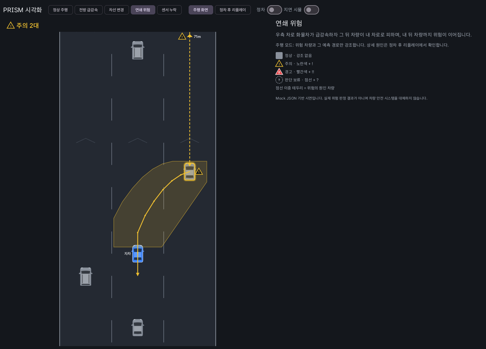

# PRISM visualization-engine

주변 차량의 위치·움직임과 **다른 엔진이 계산한** 미래 위험도를 차량용 화면에 표시하는 Android 라이브러리 모듈입니다.
(Jetpack Compose Canvas 기반 2D 탑다운 뷰)

- 담당: 시각화·UI/UX 엔진 / 브랜치: `feature/visualization`
- 이 모듈은 위험을 **판단하지 않습니다.** RiskFrame에 들어온 등급을 운전자가 이해하기 쉽게 표시만 합니다.
- 차량의 기존 안전 시스템(ADAS)을 대체하거나, 실시간 충돌 방지 장치로 쓰는 것을 전제로 하지 않습니다.
- 시연 데이터(`demo/`)는 **손으로 만든 Mock**입니다. 표시된 위험 등급은 어떤 알고리즘 성능도 의미하지 않습니다.



---

## 1. 폴더 구조

```
visualization-engine/
├── build.gradle.kts / settings.gradle.kts   # Android Library 모듈(독립 빌드 가능), demo 앱 포함
├── model/       # 계약 모델(VehicleFrame v1, PredictionFrame, RiskFrame) + JSON 변환 + 원인 코드 문구
├── rendering/   # 좌표 변환(Viewport), 차량 기하, 탑뷰 차량 도형(VehicleShapes), 위험 스타일, SceneBuilder(표시 규칙), 프레임 보간 — Android 의존 없음
├── overlays/    # Compose DrawScope 렌더러: RoadLayer, VehicleRenderer, RiskOverlay, TrajectoryOverlay
├── ui/          # 공개 Composable: RadarScreen, RadarSceneView, RadarStatusBar, RiskLegend, LevelIcon
├── replay/      # ReplaySession / ReplayJson / ReplayScreen / RiskTimeline
├── demo/        # 독립 실행 데모 앱 + Mock 시나리오 생성기 + 샘플 JSON(assets/scenarios)
├── tests/
│   ├── unit/        # JVM 단위 테스트(45개, 데모 모듈 3개 별도. 팀 호환성 4개는 팀 저장소 안에서만 실행)
│   ├── android/     # 계측 테스트: Compose UI, 해상도, 생명주기, 렌더링 비용(12개)
│   └── results/     # 테스트·FPS 측정 결과
├── docs/        # 스크린샷, 시연 영상, 예제 입력·출력
├── README.md
└── THIRD_PARTY_NOTICES.md
```

---

## 2. 빠른 실행

요구 사항: JDK 17, Android SDK(compileSdk 37), AGP 9.5.1, Kotlin 2.2.10. 이 폴더 단독으로 빌드할 수 있습니다.

```bash
cd visualization-engine
./gradlew :testDebugUnitTest :demo:testDebugUnitTest     # JVM 단위 테스트
./gradlew :connectedDebugAndroidTest                     # 계측 테스트(에뮬레이터/기기 필요)
./gradlew :demo:installDebug                             # 데모 앱 설치
```

데모 앱 인텐트 옵션(시연·스크린샷 자동화용):

```bash
adb shell am start -n ai.prism.visualization.demo/.DemoActivity \
  --es scenario chain        # normal | front_brake | lane_change | chain | sensor_dropout
  --es tab drive             # drive(주행 화면) | replay(정차 후 리플레이)
  --es stopped true          # 정차 여부(실제로는 vehicle-integration 이 Pleos Vehicle SDK 로 판단)
  --el t_ms 1800             # 특정 시점에 멈춘 화면
  --ei stress 100            # FPS 측정 모드(차량 N대, logcat 태그 PRISM_FPS)
```

다른 엔진이 없어도 `demo/src/main/assets/scenarios/*.json`(Mock JSON)으로 실행됩니다.

---

## 3. 공개 API

### 3.1 주행 중 레이더

```kotlin
RadarScreen(
    vehicleFrame = vf,                 // VehicleFrame? — null 이면 "차량 데이터 없음"
    predictionFrame = pf,              // PredictionFrame? (선택)
    riskFrame = rf,                    // RiskFrame? — null 이면 모든 차량 중립색 + 안내
    mode = DisplayMode.DRIVING,        // DRIVING(강조 최소화) | DETAIL(정차 후 상세)
    config = RadarConfig(road = RoadConfig(laneCount = 3, laneWidthM = 3.5f, egoLaneIndex = 1)),
    nowMs = clock.nowMs(),             // 지정하면 데이터 지연을 감지해 경고를 보류
    modifier = Modifier.fillMaxSize(),
)
```

### 3.2 정차 후 리플레이

```kotlin
val session: ReplaySession = ReplayJson.parse(jsonString).session   // 또는 ReplaySession(...) 직접 생성
ReplayScreen(
    session = session,
    isVehicleStopped = isParked,       // false 면 상세 분석을 숨김
    state = rememberReplayState(session.id),   // 재생 위치·선택 차량·속도는 화면 재생성 후에도 복원
)
```

### 3.3 하위 API

| API | 용도 |
|---|---|
| `ContractJson.parseVehicleFrame(String \| JSONObject)` | VehicleFrame JSON → 모델. 깨진 차량은 건너뛰고 `ParseResult.warnings`로 보고 |
| `ContractJson.parsePredictionFrame(String | JSONObject)`, `ContractJson.parseRiskFrame(String | JSONObject)` | PredictionFrame·RiskFrame JSON → 모델 |
| `ReplayJson.fromJsonl(id, title, vehicleJsonl, predictionJsonl, riskJsonl)` | 팀 시나리오 형식(프레임별 JSONL 3개)을 리플레이 세션으로 묶기 |
| `ContractJson.toJson(VehicleFrame \| PredictionFrame \| RiskFrame \| RoadConfig)` | 모델 → `JSONObject` |
| `ReplayJson.parse(String).session`, `ReplayJson.toJson(ReplaySession): String` | 리플레이 파일(이 모듈 자체 포맷, `prism.visualization.replay/0.1`) |
| `SceneOptions(trajectoryReference, staleAfterMs = 500, riskSyncToleranceMs = 300, maxEmphasizedInDriving = 3)` | 표시 규칙 조정. `RadarConfig(sceneOptions = …)`로 전달 |
| `ViewportConfig(aheadM = 60, behindM = 25, roadWidthFraction = 0.58, maxLateralExaggeration = 5)` | 보이는 범위·횡방향 확대. `RadarConfig(viewport = …)`로 전달 |
| `SceneBuilder.build(...)` | 계약 프레임 → 그리기 독립적인 `Scene`. Android 의존이 없어 JVM 테스트 가능 |
| `RadarSceneView(scene)` | 이미 만든 Scene 을 그림(리플레이·벤치마크) |
| `DrawScope.drawRadarScene(scene, transform, textMeasurer)` | 오프스크린·커스텀 Canvas 에 그리기 |
| `RiskLegend()`, `LevelIcon(level)`, `RadarStatusBar(scene)` | 범례·아이콘·상태 줄 |
| `RadarTestTags`, `ReplayTestTags` | 통합 UI 테스트용 태그 |

---

## 4. 다른 엔진과 연결하는 방법

```
vehicle-integration ──VehicleFrame──┐
prediction-engine  ──PredictionFrame├──▶ (통합 측 StateFlow) ──▶ RadarScreen / ReplayScreen
risk-engine        ──RiskFrame──────┘
```

1. **Gradle 포함** (PRISM 루트의 공통 파일이라 통합 담당자 승인이 필요합니다)
   ```kotlin
   // 루트 settings.gradle.kts
   include(":visualization-engine")
   include(":visualization-engine:demo")      // 데모 앱도 빌드할 때만

   // 루트 build.gradle.kts — 이 모듈은 플러그인을 버전 없이 선언하므로 루트에서 버전을 정해야 함
   plugins {
       id("com.android.library") version "9.5.1" apply false
       id("com.android.application") version "9.5.1" apply false
       id("org.jetbrains.kotlin.plugin.compose") version "2.2.10" apply false
   }

   // 앱 모듈
   dependencies { implementation(project(":visualization-engine")) }
   ```
   - 이 폴더의 `settings.gradle.kts`와 `gradlew`는 독립 빌드용입니다. 루트 빌드에서는 쓰이지 않습니다.
   - 위 구성을 가짜 PRISM 루트 프로젝트로 재현해서 `:visualization-engine:demo:assembleDebug`와 `:visualization-engine:testDebugUnitTest`가 성공하는 것을 확인했습니다.
   - Maven 저장소는 `google()`, `mavenCentral()`만 필요합니다.
2. **데이터 공급**: 통합 측이 세 프레임을 `StateFlow`로 모아 `collectAsState()`로 넘기면 됩니다.
   이 모듈은 스레드·구독을 소유하지 않습니다. 메인 스레드에서는 그리기만 합니다.
3. **JSON으로 받는 경우**
   - 문자열 JSON은 `ContractJson.parseVehicleFrame(json)`, `ContractJson.parsePredictionFrame(json)`, `ContractJson.parseRiskFrame(json)`로 바꿉니다.
   - 시나리오 폴더(`vehicle_frames.jsonl` 등)는 `ReplayJson.fromJsonl(...)`로 바로 리플레이할 수 있습니다.
   - `.value`가 모델이고, `.warnings`는 로그로 남기면 됩니다.
   - Kotlin 객체로 직접 받는다면 `model/Contracts.kt`의 데이터 클래스를 쓰면 됩니다.
4. **정차 여부**: 통합 측이 Pleos Vehicle SDK(기어·속도)로 판단해 `isVehicleStopped`와 `mode`에 넘깁니다.
5. **리플레이 기록**: 통합 측이 프레임 세 개를 `ReplayFrame`으로 묶어 쌓으면 `ReplayScreen`에서 그대로 재생됩니다.
   저장 포맷은 `ReplayJson.toJson`을 씁니다.

---

## 5. 데이터 계약

팀 저장소(qwon4466/PRISM)의 실제 계약에 맞춰 구현했습니다(2026-11-11 확인).

| 프레임 | 기준 파일(팀 저장소) | 시각화 엔진이 읽는 필드 |
|---|---|---|
| VehicleFrame v1 | `simulation-engine/schema/vehicle_frame.v1.schema.json` | `schema_version`, `timestamp_ms`, `coordinate_system`(= `ego_local_m`), `ego_id`, `vehicles[] {id, x, y, vx, vy, heading_rad, length_m, width_m, lane_id(문자열)}` |
| PredictionFrame 1.0 | `prediction-engine/src/main/resources/prediction_frame.schema.json` | `predictions[] {vehicle_id, trajectories[] {mode, confidence, points[] {dt_ms, x, y, heading_rad}}}` |
| RiskFrame 1.0 | `vehicle-integration/replay/.../Contracts.kt` (JSON Schema 파일 없음) | `risk_objects[] {vehicle_id, risk_level, reason_codes[], ttc_s, risk_zones[] {dt_ms, polygon[]}}` |

- 좌표·각도: x = 오른쪽, y = 전방, 전방 주행 heading = π/2, `vx`/`vy` = 지면 속도. 팀 샘플과 일치하는 것을 확인했습니다.
- 예측 궤적·위험 영역: 기준 시점의 자차 좌표계에 고정된 값으로 받습니다. 화면에는 `dt_ms` × 자차 속도만큼 빼서 **자차 대비 상대 운동**으로 그립니다(`TrajectoryReference.RELATIVE_TO_EGO`).
- 원인 코드: 팀 샘플이 쓰는 7개(`HARD_BRAKING`, `FRONT_CLOSING`, `REAR_CLOSING`, `CHAIN_DECEL`, `LANE_CHANGE_INTRUSION`, `PATH_OVERLAP`, `SENSOR_DROPOUT`)를 한국어 문구로 표시합니다. 모르는 코드는 원문 그대로 표시합니다.
- 계약에 없는 **선택 필드(제안)**: `source_vehicle_ids`(연쇄 위험 화살표), `trajectory_mode`(위험 판단에 쓰인 궤적 강조), `message`, `vehicle_class`. 없으면 해당 표시만 생략하고 오류는 내지 않습니다.
- 호환성 검증: 팀 저장소 안에서 `TeamContractCompatibilityTest`가 vehicle-integration의 시나리오 6개, prediction-engine 예시, simulation-engine 샘플을 읽기만 해서 경고 0건으로 해석되는지 확인합니다.
- 남은 확인 사항은 [docs/CONTRACT_CONFIRMATION_REQUEST.md](docs/CONTRACT_CONFIRMATION_REQUEST.md)에 정리했습니다.

---

## 6. UX 원칙과 구현

| 요구 | 구현 |
|---|---|
| NORMAL 회색 / WATCH 노란색 / WARNING 빨간색 / UNKNOWN 점선·별도 기호 | `RiskStyle`. UNKNOWN은 빨간색을 쓰지 않음 |
| 색상만으로 전달하지 않기 | 등급마다 **아이콘 모양**(없음 / 테두리 삼각형 / 채운 삼각형 / 점선 원), **글자**(! / !! / ?), **선 모양**(실선 / 점선), 상태 줄 **텍스트**(경고 1대 등)를 함께 씀. 타임라인은 **막대 높이**로도 등급을 구분 |
| 과도한 애니메이션 금지 | 깜빡임·펄스 없음. 차선 점선도 스크롤하지 않음. 실시간 화면은 보간하지 않음(지연 방지) |
| 경고 과장 금지 / 센서 누락 시 경고 억제 | 데이터 지연(기본 500ms), RiskFrame 시각 불일치(300ms), **위치를 모르는 차량**은 WATCH/WARNING이어도 UNKNOWN(판단 보류)으로 낮춤 |
| 필요한 위험 객체만 강조 | 주행 모드에서는 위험 등급 상위 3대만 궤적·영역 표시, 위험 판단에 쓰인 후보 궤적만 그림. 화면 밖 위험 차량은 가장자리에 방향 + 거리만 표시 |
| 상세 분석은 정차 후에만 | `ReplayScreen(isVehicleStopped = false)`이면 상세 화면 대신 안내 문구만 표시. 주행 모드에서는 차량 탭 비활성 |
| 차선·차량 방향 표시 | 차선별 진행 방향 셰브런, 탑뷰 자동차 그래픽(앞유리·보닛 방향), heading 회전 |
| 차량 그래픽 | **승용차·SUV·대형 화물차** 탑뷰를 직접 만든 벡터 도형으로 그림(외부 이미지 없음). 자차 = 파란색, 다른 차량 = 회색. WATCH = 노란 외곽선, WARNING = 빨간 외곽선(+ 같은 색 테두리 띠), UNKNOWN = 반투명 차체 + **파란 점선** + ? 기호, 데이터 지연 = **회색 점선 + 흐리게 + "지연" 칩**(판단 보류와 구분). 차종은 `length_m`·`width_m`으로 추정 |
| 위험 영역·예측 궤적 | 세 가지를 구분: **예측 이동 경로**(선 + 시간 마디), **미래 점유 영역**(아주 옅은 채움 + 점선), **충돌 위험 영역**(같은 시점 자차 점유 영역과 겹치는 영역, 진한 채움 + 실선). 모두 차량 그래픽 **아래** 레이어에 옅게 그려 차량을 가리지 않음 |
| 트래킹 ID·등급 라벨 | 주행 모드: 위험 차량만 [아이콘] 등급 칩("! 주의", "!! 경고"). 정차 후 상세: 모든 차량 ID, 위험 차량은 "ID · 등급" 칩. 원인 차량은 "원인" 칩. ID 기준 보간(리플레이), 사라진 ID를 끌고 다니지 않음 |
| 연쇄 위험 관계 | RiskFrame `source_vehicle_ids`로 **확인된 관계만** 원인(○) → 영향받는 차량(화살촉) 실선으로 연결. 자차 위험(강조 대상)과 연결된 관계만 그리고, 그 원인 차량에만 "원인" 표시 |
| 그리기 순서 | 도로 → 미래 점유 영역 → 충돌 위험 영역 → 예측 경로 → 차량 → 연쇄 위험 연결선 → 위치 미상 차량 → 라벨 칩 → 화면 밖 표시 |

---

## 7. 오픈소스 조사와 기술 선택

| 저장소 | Kotlin/Android 호환 | PRISM에 필요한 기능 | 에뮬레이터 | 부하 | 결정 |
|---|---|---|---|---|---|
| **Jetpack Compose (androidx)** Apache-2.0, 매일 커밋 | 공식 지원, minSdk 21+ | Canvas `DrawScope`(Path, 점선 PathEffect, 텍스트), 제스처, 상태 복원 | 동작 확인(Pleos AVD) | 2D 경로 수백 개 수준은 충분(아래 측정) | **P0 채택** — Maven 의존성 |
| **Vico** Apache-2.0, 2026-11-08 커밋 | Compose Multiplatform. 최신 버전은 Kotlin 2.4.21로 빌드 | 위험 지표 그래프 | 미검증 | 경량 | **미채택** — 필요한 그래프는 위험 등급 타임라인 하나뿐이라 Canvas로 직접 구현. 의존성과 Kotlin 버전 상향을 피함 |
| **Filament** Apache-2.0, 2026-11-10 커밋, v1.80 | minSdk 21, NDK 네이티브 라이브러리 | 3D 렌더링(PBR) | 가능(GLES/Vulkan) | APK 크기·GPU 부하 큼 | **P2 검토만** — 2D로 시연 요구를 충족 |

적용 방식은 **패키지 설치(Gradle Maven 의존성)**입니다.
- submodule과 vendoring은 쓰지 않습니다. 공식 바이너리로 충분하고 라이선스 고지도 단순해서입니다.
- 기하 변환·렌더러·타임라인은 직접 구현했습니다.

---

## 8. 테스트와 성능

전체 결과: [tests/results/RESULTS.md](tests/results/RESULTS.md)

| 구분 | 내용 | 결과 |
|---|---|---|
| JVM 단위(라이브러리 51 + 데모 3 = 54) | **팀 실제 출력 호환성**, 표시 규칙(충돌 영역 판정·원인 강조 범위·데이터 지연), 차량 도형·차종 분류, 계약 파싱·깨진 데이터, 좌표 변환·해상도, 등급 스타일·색 전환, 데이터 누락·지연·동기화, 주행 모드 강조 제한, 5개 시나리오 표시 규칙, 리플레이 이벤트·보간, Mock 데이터 충돌 없음 | 54/54 통과 |
| Compose UI 계측(12) | 픽셀 색으로 NORMAL→WATCH→WARNING→UNKNOWN 전환 검증, 데이터 누락 안내, 지연 시 경고 억제, 모드별 탭, 재생/일시정지, 원인 패널, 주행 중 잠금, **상태 복원(생명주기)**, 가로 해상도 5종, 렌더링 비용 | 11/12 통과 |
| **합계** | | **65/66 통과** (렌더링 비용 벤치마크 1건은 에뮬레이터 과부하로 실패. 같은 세션에서 변경 전 버전도 똑같이 실패, RESULTS.md 참고) |

**실제 화면 FPS**: 데모 release 빌드를 Pleos_Connect AVD(호스트 GPU, 60 Hz)에서 쟀습니다.
- 조건: 상세 모드에서 모든 차량이 매 프레임 움직이고, 워밍업 구간은 뺀 중앙값입니다.
- 탑뷰 차량 그래픽(스프라이트 캐시) 적용 후, 이전 사각형 그래픽과 같은 조건에서 번갈아 측정한 중앙값입니다.

  | 차량 수 | 10 | 50 | 100 | 200 |
  |---|---|---|---|---|
  | 이전 사각형 | 59.5 | 57.3 | 45.6 | 39.8 |
  | 탑뷰 그래픽 | 60.0 | 59.5 | 56.8 | 45.9 |

- 측정 조건 전체와 에뮬레이터 상태에 따른 편차는 RESULTS.md 3절에 있습니다.
- 에뮬레이터 수치라 실차 SoC 성능을 보장하지 않습니다.

---

## 9. 시연 자료

| 파일 | 장면 |
|---|---|
| `docs/screenshots/polish/side_*.png` | **UI/UX 개선 전후 비교**(연쇄 위험 전조·끼어들기, 차선 변경, 리플레이 상세 패널). 아래 01~08은 개선 전 화면입니다 |
| `docs/screenshots/01_normal_drive.png` | 정상 주행 — 모든 차량 중립 |
| `docs/screenshots/02_front_brake_drive.png` | 전방 급감속 — 앞 차량 경고, 후속 차량 변화 |
| `docs/screenshots/03_lane_change_drive.png` | 차선 변경 — 진입 예상 차량만 강조 + 차선 변경 경로 |
| `docs/screenshots/04a_chain_drive_early.png` | 연쇄 위험 전조 — 화면 밖 화물차(71m) → 우측 차량 → 내 경로 |
| `docs/screenshots/04b_chain_drive_cutin.png` | 연쇄 위험 — 끼어들기 경고 |
| `docs/screenshots/05_sensor_dropout_drive.png` | 센서 누락 — 판단 보류(점선 + ?), 경고 억제 |
| `docs/screenshots/06_chain_replay.png`, `07_dropout_replay.png` | 정차 후 리플레이 — 원인·등급 변화·타임라인 |
| `docs/screenshots/08_replay_locked_while_driving.png` | 주행 중 리플레이 잠금 |
| `docs/screenshots/tests/*.png` | 계측 테스트 캡처(해상도 5종, 등급별 레이더) |
| `docs/prism_chain_replay.mp4`, `docs/prism_chain_drive.mp4` | 재생 시연 영상(에뮬레이터 화면 녹화) |
| `docs/examples/` | 예제 입력(계약 프레임 3종)과 출력(Scene 요약) |
| `docs/HANDOFF_INTEGRATION.md` | 통합 담당자용 요약(연결 방법·필요한 값·검증 상태) |
| `docs/CONTRACT_CONFIRMATION_REQUEST.md` | 계약 필드별 확정·추정·제안 구분과 확인 요청 |

---

## 10. 제한 사항

- **PRISM 저장소에 아직 반영하지 않았습니다.**
  - 작업 시점에 저장소 URL이 없었고, GitHub CLI도 로그인되어 있지 않았습니다.
  - 그래서 `feature/visualization` 브랜치 커밋과 Pull Request를 만들지 않았습니다.
  - 이 폴더는 `C:\Users\jjssk\AndroidStudioProjects\prism-work\visualization-engine`에 있습니다. 저장소를 받으면 이 폴더만 옮겨 커밋합니다.
- 계약 JSON Schema를 받지 못해 5절의 가정 위에서 구현했습니다.
- Pleos Vehicle SDK(정차 판단)와 실제 엔진 출력은 연결하지 않았습니다. 이는 vehicle-integration 담당 범위입니다.
- 곡선 도로와 차선 형상은 지원하지 않습니다(직선 도로 가정).
- 성능 수치는 에뮬레이터 측정값입니다. 계측 테스트의 렌더링 비용은 debuggable APK의 CPU 래스터 기준이라 절대 성능 지표로 쓰지 않습니다.
